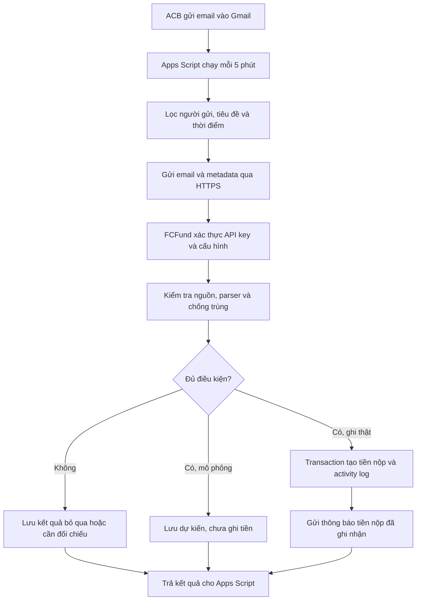

# Tự động ghi nhận tiền nộp qua email ACB

**Trạng thái:** Đã triển khai trong source; migration 0023 đã áp dụng production ngày 17/11/2026. Cần deploy và cài Apps Script; chưa bật ghi nhận thật. Xem [hướng dẫn cài đặt](./18-cai-dat-gmail-acb.md).
**Ngày:** 17/11/2026.
**Phạm vi:** Gmail → Google Apps Script → API FCFund; khoảng 30 email/tháng.

## 1. Quyết định nghiệp vụ

- Apps Script chạy theo lịch mỗi 5 phút bằng tài khoản Gmail nhận thông báo ACB.
- Chỉ tự ghi nhận giao dịch tiền vào có đủ dữ liệu hợp lệ và nhận diện chính xác một thành viên bằng mã thanh toán.
- Email không khớp không tạo giao dịch tiền nộp. Admin/Thủ quỹ tiếp tục nhập tay theo nghiệp vụ hiện tại; không tự tạo giao dịch chờ duyệt tài chính.
- Chỉ xử lý email nhận từ thời điểm bật chính thức. Mốc này được lưu tại server và kiểm tra lại khi nhận API.
- Số tiền ghi nhận là tiền Ghi có thực nhận; cho phép đóng một phần hoặc đóng dư, không bắt buộc bằng số nợ hay số tiền QR.
- Tạo `fund_transactions` với `direction=IN`, `kind=MEMBER_PAYMENT`; không tạo khoản phải thu `member_charges`, không nhập đè số dư, không phân bổ tiền vào từng loại thu.
- Email không chứng minh người chuyển đã quét QR. Nội dung chứa đúng mã thanh toán cũng được xử lý dù được nhập bằng tay.

## 2. Nội dung chuyển khoản

Mẫu mới được dùng cho QR động và deeplink:

```text
FCF A7K9P2 THANH HAI
```

- `FCF` là tiền tố nhận diện ứng dụng.
- `A7K9P2` là ví dụ mã thanh toán, không phải mã thực tế của Thanh Hải.
- Mã gồm 6 ký tự chữ/số viết hoa, tránh ký tự dễ nhầm; sinh ngẫu nhiên có kiểm tra unique toàn hệ thống, bất biến và không tái sử dụng cho người khác.
- Lưu riêng `payment_reference` trên thành viên; không dùng UUID, số điện thoại hoặc phụ thuộc `member.code` có thể chỉnh sửa.
- Tên bỏ dấu dùng để con người đối chiếu; hệ thống nhận diện bằng mã, không fuzzy-match tên.
- Đặt tiền tố và mã ở đầu; nếu giới hạn độ dài thì chỉ rút gọn tên, không cắt mã. Giữ giới hạn tương thích hiện tại 40 ký tự.
- Parser chỉ chấp nhận token đầy đủ, độc lập; chuẩn hóa hoa/thường và khoảng trắng. Không đoán mã khi bị thiếu/cắt hoặc khi nội dung chứa nhiều mã khác nhau.
- Mã phải thuộc thành viên đang hoạt động của đúng CLB nhận tiền.
- Nội dung cũ theo tên đội + tên + ngày không tự nhận diện theo thiết kế mới; xử lý nhập tay.

## 3. Cấu hình dành cho Admin

Trong nhóm cài đặt tích hợp, thêm mục **Ghi nhận tiền nộp qua email ACB**:

| Trường | Quy tắc |
|---|---|
| Trạng thái | Tắt / Mô phỏng / Tự động ghi nhận |
| Địa chỉ Gmail nhận | Hộp thư được phép gửi dữ liệu vào tích hợp |
| Người gửi được phép | Mặc định `mailalert@acb.com.vn` |
| Tiêu đề email | Mặc định `ACB-Dich vu bao so du tu dong`; Admin có thể cấu hình, bắt buộc trước khi bật |
| Tài khoản nhận | Đối chiếu tài khoản quỹ; nếu email che số, lưu mẫu hiển thị thực tế để so khớp |
| API endpoint | Hiển thị URL để sao chép vào Apps Script |
| API key | Admin tạo, thu hồi hoặc thay key; chỉ hiển thị đầy đủ một lần |
| Thời điểm bắt đầu | Thời điểm bật ghi nhận thật, lưu UTC và hiển thị Asia/Ho_Chi_Minh |
| Kết nối gần nhất | Lần gọi hợp lệ, lỗi gần nhất, số email đã xử lý |

- Tiêu đề là header `Subject`, không phải một đoạn trong body. So khớp toàn bộ sau khi giải mã MIME, chuẩn hóa Unicode NFC và bỏ khoảng trắng đầu/cuối; giữ nguyên hoa/thường và nội dung bên trong. Không dùng contains hoặc tự chấp nhận tiền tố `Fwd:`/`Re:`.
- Tiêu đề ACB thực tế do chủ quỹ cung cấp: `ACB-Dich vu bao so du tu dong`. Đây là giá trị mặc định cho cấu hình và bộ lọc Apps Script; server luôn kiểm tra theo cấu hình hiện hành.
- Tiêu đề và địa chỉ người gửi là điều kiện lọc, không thay thế kiểm tra nguồn email.
- API key được lưu dạng hash hoặc mã hóa phù hợp với giao thức sử dụng; không hiển thị trong log, chatter, URL hoặc mã nguồn. Với Bearer key, server chỉ cần lưu hash.
- Apps Script lưu key trong Script Properties. Key ràng buộc đúng CLB và tích hợp; server suy ra CLB từ key, không tin `clubId` do client gửi.
- Thay đổi cấu hình có audit log; log không chứa giá trị key.
- Tắt/bật lại không tự lùi mốc bắt đầu hoặc nhập lại lịch sử. Nhập lịch sử nằm ngoài phạm vi giai đoạn này.

## 4. Luồng xử lý



### 4.1. Apps Script

- Chủ hộp thư cấp quyền đọc Gmail và gọi HTTP một lần; không cung cấp mật khẩu Gmail cho FCFund.
- Dùng lịch chạy định kỳ, không phụ thuộc trình duyệt hoặc ứng dụng đang mở.
- Dùng lock tránh hai lượt script xử lý đồng thời; phân trang và giới hạn batch.
- Lưu trạng thái theo từng message ID, không chỉ thread ID vì cùng thread có thể có nhiều thông báo giao dịch.
- Không dựa vào trạng thái đã đọc/chưa đọc của người dùng để quyết định đã xử lý.
- Gửi ID email, ID hộp thư, ngày email, người gửi, tiêu đề, body cần thiết và thông tin xác thực nguồn. Chỉ gửi email ACB phù hợp, không gửi toàn bộ hộp thư.
- Kiểm tra header xác thực do Gmail đáng tin cậy cung cấp: DKIM/DMARC và domain liên quan ACB; không tin một header `Authentication-Results` bất kỳ do người gửi tự chèn. Cách lấy và kiểm tra phải được xác minh bằng email ACB thật trước khi bật ghi nhận.
- Chỉ đánh dấu hoàn tất khi server trả kết quả cuối: đã ghi nhận, đã xử lý hoặc bỏ qua có lý do.
- Timeout, HTTP 429 hoặc 5xx được thử lại có backoff; HTTP 401/403 báo lỗi cấu hình, không lặp vô hạn.
- Không ghi body đầy đủ, API key hay số tài khoản vào execution log.

### 4.2. API FCFund

Endpoint dự kiến: `POST /api/integrations/acb-email`.

- HTTPS, xác thực Bearer API key, giới hạn kích thước payload và tốc độ gọi.
- Server kiểm tra lại cấu hình đang bật, đúng hộp thư, From, Subject, tài khoản và thời điểm; không chỉ dựa vào kết quả lọc từ script.
- Phân tích body ở dạng text, không thực thi/render HTML email trực tiếp.
- Chỉ chấp nhận đúng mẫu ACB đã kiểm thử. `Ghi có +10,000.00 VND` được đọc thành 10.000 VND; số dư sau giao dịch không phải số tiền nộp.
- `Ghi nợ`, ngoại tệ, số tiền không hợp lệ, phần lẻ khác 0, nội dung nhiều giao dịch/không rõ được bỏ qua có lý do.
- Chỉ nhận một mã thành viên hợp lệ. Nội dung lương hoặc chuyển khoản không chứa mã không tự ghi nhận.
- Ngày nộp dùng ngày giao dịch được đọc từ email theo Asia/Ho_Chi_Minh; nếu mẫu chỉ có ngày thông báo thì lưu rõ nguồn ngày và kiểm tra bằng mẫu thực tế. Không tự coi `Date` của email là giờ giao dịch chính xác.
- Bản ghi xử lý, giao dịch tiền nộp và activity log phải tạo trong cùng transaction và có unique constraint chống gọi đồng thời.
- Thông báo tiền nộp gửi sau commit; lỗi Push không rollback tiền nộp.

## 5. Dữ liệu và chống trùng

Các thay đổi schema trong migration 0023, đã áp dụng production ngày 17/11/2026:

| Thành phần | Nội dung |
|---|---|
| `members.payment_reference` | Mã thanh toán unique, cố định |
| Cấu hình tích hợp theo CLB | Người gửi, Subject, tài khoản, hộp thư, chế độ, mốc bắt đầu, thông tin key |
| Bảng email/giao dịch nhập | Message ID, hộp thư, metadata cần thiết, số tiền, ngày, nội dung, thành viên nhận diện, trạng thái, lý do, liên kết giao dịch |
| `fund_transactions.source` | `MANUAL` / `ACB_EMAIL`; giao dịch cũ backfill `MANUAL` |

- Unique theo tích hợp/hộp thư + Gmail message ID. Cùng email gọi API nhiều lần hoặc gửi lại sau timeout chỉ tạo một lần tiền nộp.
- Lưu mã giao dịch ngân hàng nếu mẫu có cung cấp và kiểm tra unique trong phạm vi ngân hàng/tài khoản.
- Mẫu đã cung cấp chưa có mã giao dịch ngân hàng. Với email khác ID nhưng cùng tài khoản, số tiền, ngày và nội dung, đánh dấu nghi trùng để con người đối chiếu; không tự cộng tiền lần nữa. Không khẳng định đây chắc chắn là cùng giao dịch vì một người có thể nộp hai lần giống nhau.
- Mô phỏng dùng dữ liệu trước mốc bật thật không được tự chuyển thành tiền nộp khi đổi chế độ.
- Không tự coi email là bằng chứng tuyệt đối cho ngân hàng; bật ghi thật chỉ sau khi xác minh luồng nguồn và mẫu thực tế.
- Giới hạn quyền xem dữ liệu email cho Admin và người được cấp quyền quản lý tài chính; không công khai email hoặc tài khoản nhận trong báo cáo public.

## 6. Hủy hoặc sửa giao dịch tự động

- Tuân theo policy sửa/xóa giao dịch đang có; không mở thêm quyền chỉ vì nguồn là API.
- Xóa mềm giao dịch cần lý do; lưu người thực hiện và dữ liệu trước/sau trong chatter.
- Khi xóa, tổng tiền đã nộp, quỹ thực có và số dư thành viên được tính lại theo giao dịch chưa xóa.
- Bản ghi email giữ trạng thái `REVERSED` và liên kết giao dịch đã xóa. Gửi lại email không tạo lại tiền nộp.
- Sửa nhầm thành viên có kiểm tra đúng CLB và lưu audit; nguồn `ACB_EMAIL` và dữ liệu gốc vẫn giữ nguyên.
- Nếu đã ghi nhận tay trước khi email được xử lý, người quản lý cần đối chiếu. Trường hợp nghi trùng phải được giữ lại để kiểm tra, không cộng tự động chỉ vì mã khớp.

## 7. UI Thu & chi

- List thêm cột **Nguồn**, hỗ trợ ẩn/hiện bằng component chung.
- Nhãn `API tự động · ACB` hoặc `Nhập tay`; card mobile hiển thị nhãn tương ứng.
- Người tạo hiển thị riêng: giao dịch tự động là `Hệ thống`, không giả danh Admin đã tạo API key.
- Thêm bộ lọc nguồn; các mini-stat vẫn tính theo danh sách đã lọc như nghiệp vụ hiện có.
- Chi tiết giao dịch API hiển thị thời điểm nhận email, thời điểm ghi nhận, mã đối chiếu và lịch sử sửa/hủy. Không hiện API key.
- Cài đặt tích hợp có lịch sử xử lý `SIMULATED`, `RECORDED`, `IGNORED`, `REVIEW_REQUIRED`, `REVERSED` với lý do rõ ràng. Đây là log tích hợp, không phải khoản thu chờ duyệt.

## 8. Kế hoạch triển khai và nghiệm thu

1. Subject thực tế đã xác nhận: `ACB-Dich vu bao so du tu dong`. Tiếp tục xác minh cách hiển thị tài khoản và header xác thực ACB trong Gmail khi cấu hình tích hợp.
2. Tạo schema, migration, API key/config và nội dung QR mới; migration không tự ghi tiền từ email cũ.
3. Triển khai Apps Script và hướng dẫn cấp quyền, Script Properties, trigger, xem lỗi.
4. Chạy mô phỏng bằng email thực tế; so sánh thành viên, số tiền, ngày và lý do bỏ qua.
5. Bật ghi nhận thật với mốc thời gian mới sau khi kiểm thử đạt.

Các case bắt buộc:

- Tiêu đề đúng/sai, From đúng/sai, xác thực nguồn không đạt, sai hộp thư/tài khoản.
- Ghi có hợp lệ; Ghi nợ; số dư mới khác số tiền giao dịch; số tiền có dấu phân cách; mẫu không rõ.
- Mã đúng, mã sai, nhiều mã, thành viên inactive hoặc khác CLB.
- Email trước mốc bật; mô phỏng không thay số dư; tắt tích hợp; key bị thu hồi.
- Cùng message gửi lại, gọi đồng thời, mất phản hồi sau commit, email khác ID nghi cùng giao dịch.
- Thành viên nộp một phần/đóng dư; sửa người nhận; xóa mềm rồi gửi lại email không tạo lại.
- Cột/lọc nguồn trên PC và mobile; notification lỗi không làm mất giao dịch đã ghi nhận.

## 9. Tham khảo

- [Apps Script gọi API ngoài](https://developers.google.com/apps-script/guides/services/external).
- [Trigger theo lịch](https://developers.google.com/apps-script/guides/triggers/installable).
- [Hạn mức Apps Script](https://developers.google.com/apps-script/guides/services/quotas).
- [Luồng QR hiện tại](./15-thanh-toan-cong-no-qua-ung-dung-ngan-hang.md).
